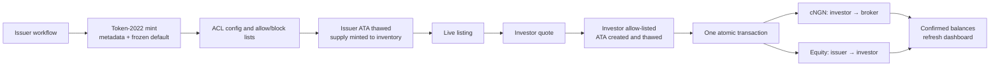

# Rabovel demo

Rabovel demonstrates a primary market for tokenized equities: an issuer defines an asset, submits simulated backing evidence, creates and funds its on-chain inventory, and publishes a live listing. An approved mock-KYC investor can connect a wallet, review the backing and simulated price, buy with cNGN, and see the resulting holding and portfolio value.

> Demo only: backing verification, market prices and KYC approval are simulated. The tokens do not represent a legal claim on real shares.

## What is Rabovel?

Rabovel is a prototype for issuing and settling tokenized representations of Nigerian equities on Solana. It connects issuers and investors through a familiar investment interface while using Token-2022, wallet-based ownership and cNGN settlement underneath. Rabovel is not intended to replace NGX, brokers or custodians; it explores how existing capital-market participants could use programmable infrastructure for asset distribution, ownership and settlement.

## How it works

The prototype demonstrates an issuer-to-investor primary-market flow:

1. An issuer defines an equity and submits simulated backing evidence.
2. Rabovel creates a zero-decimal Token-2022 mint and issues the authorized supply into the issuer’s inventory.
3. After the backing and on-chain setup are verified, the issuer publishes the asset to the investor marketplace.
4. An investor verifies ownership of a Phantom wallet and funds a cNGN token account.
5. The investor reviews the asset, backing information and simulated market quote.
6. A single atomic Solana transaction transfers cNGN from the investor to the broker and equity tokens from the issuer to the investor.

After confirmation, Rabovel reads the resulting on-chain balances to update issuer inventory, investor holdings and portfolio value.

## Why Solana?

Capital-market infrastructure requires fast settlement, low transaction costs, and the ability to support many users without making small transactions economically impractical.

Solana gives Rabovel a foundation for:

- low-cost, fast settlement
- atomic payment and asset delivery in a single transaction
- Token-2022 for representing equities with configurable issuance and transfer controls
- verifiable balances and transaction history
- compatibility with stablecoin payment rails such as cNGN
- a path toward broader on-chain financial interoperability

## Why this matters

### Why Now

Nigeria is reaching a compelling intersection of demographics, digital-asset adoption and capital-market growth.

63% of Nigerians are under 25 (UNFPA), and Nigeria ranked 6th in Chainalysis's 2025 Global Crypto Adoption Index. This means there is already a large, young population that is comfortable with digital assets and mobile-first financial products.

At the same time, participation in Nigeria's capital markets is growing. Domestic investment activity has increased significantly, major offerings like the Dangote Petroleum Refinery IPO have driven strong retail interest, and Nigeria returned to FTSE Russell Frontier Market status in September 2026.

### The Infrastructure Gap

The scale of that demand is already exposing gaps in existing infrastructure. During the Dangote IPO, several investment platforms were overwhelmed by investor traffic, with Bamboo reporting a roughly 10x traffic spike within 30 minutes (Nairametrics).

To us, that is a clear signal that investor demand is growing faster than some of the infrastructure built to serve it.

### Why Rabovel

Regulation is moving in the same direction. Nigeria's SEC treats security tokens as securities and has established rules covering digital-asset issuance, offering platforms and custody.

Together, these conditions create a timely environment for experimenting with new capital-market infrastructure: a young population, significant digital-asset adoption, growing capital-market participation, increasing digital distribution and a regulator actively developing frameworks for tokenized finance.

Rabovel sits at that intersection.

We are not trying to simply put stocks on-chain. We are exploring how blockchain infrastructure can support programmable settlement, verifiable token positions, compliance-aware transfers, stablecoin interoperability and easier access to African financial assets for both local and diaspora investors.

## Current Prototype & Limitations

The current prototype implements the core technical path from issuer setup to investor settlement:

**asset creation → simulated backing verification → Token-2022 issuance → live listing → investor quote → atomic cNGN settlement → portfolio update**

Token issuance, asset delivery and cNGN payment settle on Solana. Wallet ownership is verified through a one-time message signed with the investor’s Phantom wallet.

The prototype intentionally simplifies several production requirements:

- KYC, KYB and backing verification are simulated.
- Market prices are generated by a simulated price feed.
- Assets do not represent legally recognized ownership of real securities.
- Issuer and administrative keys use demo custody rather than HSM, MPC or qualified custodians.
- There is no production order book, secondary market, durable settlement ledger or automated reconciliation.
- Transfer hooks and per-trade on-chain authorization remain future capabilities.
- Cross-border availability would remain subject to securities, identity, custody and foreign-exchange requirements in each jurisdiction.

Rabovel currently demonstrates the infrastructure and settlement model—not a public securities offering or production brokerage.

## Solana flow

Each equity/share class has a **zero-decimal Token-2022 mint**. Rabovel uses external Token ACL and ABL Gate programs for eligibility; there is currently no custom Rabovel on-chain program.

### Instructions and ownership

| Stage | On-chain operations | Required authority |
| --- | --- | --- |
| Mint setup | System `CreateAccount`; Token-2022 metadata pointer, frozen default, pausable and inactive transfer-hook extensions; `InitializeMint2`; token metadata | Admin pays; mint keypair and issuer sign |
| Eligibility | ACL `CreateConfig`; Gate list creation, extra-meta setup and allow-list entry; permissionless ACL thaw | Rabovel demo admin |
| Issuance | Idempotent issuer ATA creation, ACL thaw, Token-2022 `MintToChecked` | Admin pays/setup; issuer mint authority signs |
| Purchase | Idempotent investor ATA creation, allow-list entry and thaw; two `TransferChecked` legs in one transaction | Issuer signs equity leg; linked investor wallet signs cNGN leg and pays the transaction fee |

Solana program ownership and asset ownership are kept separate:

- Token-2022 owns mint and token-account data; each token account records its wallet owner and mint.
- Associated Token Account derivation binds the expected wallet, mint and token program; the API reads these accounts back and rejects mismatched program owners, wallet owners or mints.
- ACL/Gate state is held in program-derived accounts owned by those external programs. The ACL MintConfig PDA becomes the mint freeze authority.
- The API accepts an investor-signed settlement only when its fee payer matches the wallet previously linked through wallet-ownership proof, and Solana verifies every required signature.
- No permanent delegate can move holder balances. Admin controls eligibility/pause operations; the issuer controls minting and its inventory transfer.

## Long-Term Vision

Rabovel’s long-term vision is a programmable distribution and settlement layer for African capital markets.

Issuers, brokers, custodians and exchanges could use shared infrastructure to create compliant digital representations of real assets, distribute them through modern investment experiences and settle ownership and payment atomically.

Regulated identity providers, licensed market data, audited backing, institutional custody and programmable transfer controls would connect on-chain activity to real legal and financial obligations.

Over time, this could support:

- broader retail and institutional distribution;
- compliant participation by local and eligible diaspora investors;
- faster settlement and automated reconciliation;
- secondary-market trading and liquidity;
- dividends, voting and other corporate actions;
- stablecoin and regulated payment interoperability;
- collateralization and other programmable financial products.

Rabovel is ultimately an experiment in answering a larger question:

**What does African capital-market infrastructure look like when it becomes programmable?**

## Future state

A production version could replace simulated KYC, backing and prices with regulated providers and audited custody; move keys to HSM/MPC or qualified custodians; add durable order, settlement and reconciliation ledgers; and activate a reviewed transfer hook or settlement program with per-trade authorization, replay protection and controlled recovery. Legal share rights, corporate actions, secondary trading, monitoring and disaster recovery would also require production-grade operating and regulatory frameworks.

## Repository layout

The Next.js frontend is in `rabovel-FE`; the companion `rabovel-BE` service owns API policy, Solana transaction construction and RPC verification.

## Test users

issuer: issuer@example.com  
investor: dyenaandappet@gmail.com

Password for both: 12345678

Full sources and technical documentation are available in the project repository.
