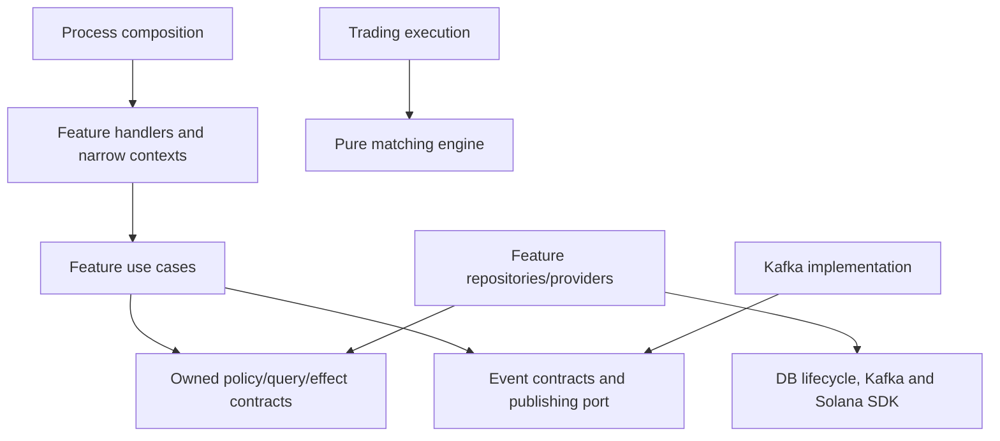

# Backend architecture

Rabovel is a modular monolith. Navigate **feature → cohesive subfeature → responsibility**. The API root is a facade; `app` composes dependencies; `http` owns shared ingress, authentication extraction, errors, observation and development documentation.

## Feature ownership

| Feature | Where to start | Responsibilities |
| --- | --- | --- |
| Identity | API `features/identity`, `crates/identity` | Password accounts, sessions, access policy, ownership challenges and linked wallets |
| Compliance | API `features/compliance`, `crates/kyc` | Terms/status, KYC cases/verdicts, sandbox and provider contracts |
| Issuer | API `features/issuer`, `crates/issuer-assets` | Organizations; drafts, media/metadata, review/backing, setup, inventory and listings |
| Catalog | API `features/catalog/instruments` | Stable IDs, NGX fixtures and published issuer lookup |
| Market data | API `features/market_data` | Prices, markets, assets and charts |
| Payments | API `features/payments/cngn` | Broker/wallet account readiness, balances and creation |
| Trading | API `features/trading`, `crates/portfolio-trading/src/trading`, `crates/matching-engine` | Orders, access/event providers, execution queries and repricing jobs |
| Settlement | API `features/settlement/direct_purchases`, `crates/settlement-orchestrator` | Direct-purchase catalog/quotes/preparation/submission; reusable pricing and chain contracts |
| Portfolio | API `features/portfolio`, `crates/portfolio-trading/src/portfolio` | Balances, merged valuation/holdings, estimated performance and activity |

An inventory change starts at `features/issuer/assets/issuance/inventory`. Its model/chain port is under the same namespace in `issuer-assets`; shared Solana implementation is beside API issuer issuance. Settlement has a separate purchase provider and owns its preparation/submission error contract. Repositories live with their feature in the owning library, not in a global directory.

## Responsibilities and dependencies

Create only modules actual behavior needs. `routes` register methods, `handlers` translate HTTP, `dto` carries request/response shapes, `usecases` coordinates behavior, `ports` defines required capabilities, `context` injects a narrow dependency set, `repositories` persists records, and `providers` implements external capabilities. `resolvers` performs meaningful catalog/account lookup; `jobs` adapts scheduled triggers. Future consumers/services do not get empty folders.

API-specific orchestration stays in complete feature modules. Shared rules, models, persistence and reusable execution operations live in selective crates. This avoids a crate per endpoint/layer. Workflows needing another process can lift their transport-independent operations and ports; libraries never import an app. Existing identity/asset schema annotations remain for wire compatibility and perform no I/O.

Cross-feature reads use account/wallet/asset/setup query interfaces. Compliance and wallet linking use profile-only writes that preserve principals. Credential creation retains its user+credential transaction. Asset/setup uniqueness and guarded SQL transitions remain explicit operations. Stores share one Postgres pool while their contracts/SQL remain feature-owned. Profile/KYC finalization and operation/asset updates remain separate effects; directory structure does not provide transaction guarantees.

`events` owns envelopes, schemas and the publishing port. `infrastructure` owns Kafka transport and Postgres connection/migration lifecycle. Redis security state/rate limits and wallet proofs belong to identity; metadata storage belongs to issuer. `solana-adapter` contains reusable instruction/account/RPC primitives.

Run `python3 scripts/check_architecture.py` to enforce boundaries. Aim for roughly 150–350 production lines per ordinary module; review above 500 for unrelated responsibilities. Separate large fixtures/scenarios without mechanically fragmenting cohesive code.

## Current execution and limits

Orders, cancellation, repricing, book/tape and balances share one engine. The immediate/5-second job starts only from production bootstrap. Engine state is process-local; fills do not settle on-chain. Direct purchases independently prepare/submit real chain transactions. Portfolio views combine these sources using documented estimates.

Settlement/reconciliation workers still log events. Constant-only wrappers and the legacy tokenization process were removed. Durable execution/outbox, reservations, consumer progress/inboxes, settlement recovery and reconciliation remain the separate [upgrade track](plans/feature-architecture-refactor.md#durable-upgrade-track).

Local Compose supplies Postgres/Redis and an opt-in test runner. Run the API on the host with Cargo Watch. Hosted startup validates public-devnet/RPC genesis before migrations; ingress protections remain. Quote settings validate at startup; bind configuration validates before dependency initialization. Debug documentation/sandbox routes remain unavailable in release or behind a gateway secret.

See [commands](commands.md), [current ownership](refactor/current-map.md), [baseline traces](refactor/flow-map.md), [retirements](refactor/retirements.md) and the [refactor plan](plans/feature-architecture-refactor.md).
