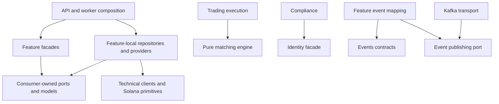

# Whole-backend feature architecture refactor

Status: whole-backend structural refactor completed and locally verified (2026-10-20). The [current map](../refactor/current-map.md) and [HTTP register](../refactor/current-routes.md) account for every baseline flow/route. The earlier pilot record below is historical. Build/test checkpoints divided implementation and review, not architectural scope.

## Evidence and intended result

Read the [flow map](../refactor/flow-map.md) and [route/source/test register](../refactor/flow-inventory.json): 63 explicit route methods, 54 paths, 98 Rust sources, 4 applications, 11 libraries, 2 operator examples, 6 migrations and 10 topics. Every F01–F37 flow has a destination below. Frontend inspection establishes legacy consumers; a broader frontend refactor and chain-program changes are outside this campaign.

Build a modular monolith navigable by business feature, then cohesive subfeature, then responsibility. Changing issuer inventory should lead to its workflow, ports, chain implementation, persistence and tests without searching identity or the API root. Preserve HTTP contracts, authorization, SQL invariants, deployment protections and chain authority behavior while moving code. Google OIDC and legacy tokenization have an agreed deprecation/removal outcome, with an explicit compatibility checkpoint.

The next capability is durable trading, settlement and reconciliation. Establish its owners and dependency boundaries now; implement durable accounting/recovery through the separately specified upgrade track. File moves alone cannot provide those guarantees.

## Agreed conventions

1. **Feature → subfeature → responsibility.** Repositories/providers belong to the workflow owner. No root-level buckets collecting business repositories, providers, consumers or use cases. Route prefixes such as `investor` describe journeys and need not become domain features.
2. **Explicit names.** Use `routes.rs`, `handlers.rs`, `dto.rs`, `usecases.rs`, `ports.rs`, `models.rs`, `repositories/`, `providers/`, `consumers.rs`, `jobs.rs` where needed. Replace the pilot's generic `adapters/http/runtime` names. No empty template folders or directory per trivial function.
3. **Cohesive subfeatures.** Drafts, backing review, mint setup and inventory have different invariants/retries; split them beneath issuer assets. Keep related operations together when they share a lifecycle. Do not split mechanically by endpoint/table.
4. **Selective crates.** Reuse identity, KYC, trading, settlement, engine, chain and event packages. Add one issuer business crate so its models/ports and SQL implementations are available without importing the app. Small API-only features stay modules. No new services or crate per layer.
5. **Narrow public facades.** `lib.rs`/`mod.rs` declare/export rather than collect workflows. Cross-feature callers use public query/policy contracts or consumer-owned ports, never another feature's SQL internals. No crate imports an app.
6. **Preserve atomicity.** Split the 29-method repository by business operation while preserving transactions, uniqueness, guarded transitions and one-use state. Shared connection does not imply shared ownership. Avoid generic CRUD/base repository abstractions.
7. **Size guides.** Aim for roughly 150–350 production lines per ordinary module; review above 500 for unrelated responsibilities. This is not a hard cap. Separate large test fixtures/data catalogs from production behavior.
8. **One policy and engine.** Keep role/onboarding/MFA checks authoritative and inject the same engine into orders, repricing, markets and portfolio. Chain holdings and simulated positions retain distinct sources.

| Name | Responsibility |
| --- | --- |
| `routes` | Register paths/methods and compose feature HTTP state |
| `handlers` | Extract input/session, invoke use case, map HTTP result; no SQL/RPC orchestration |
| `dto` | HTTP request/response and OpenAPI mapping; preserve wire shapes |
| `models` / `domain` | Feature values, facts, invariants and lifecycle without Axum/env/SQL/RPC |
| `usecases` | Named operations callable from HTTP, jobs or consumers |
| `ports` | Narrow required capabilities including error/atomicity/retry semantics |
| `repositories` | Local memory/Postgres persistence implementations |
| `providers` | Local external capability implementations: KYC, metadata, proof or chain execution |
| `consumers` | Inbound event/version/delivery adapter to use case; durability requires an actual inbox/checkpoint design |
| `jobs` | Scheduled trigger adapter; spawning/shutdown/supervision belong to app composition |
| `resolvers` | Meaningful lookups such as ticker → published asset → settlement accounts; simple conversions stay functions |

SOLID here means cohesive reasons to change, substitutable implementations honoring semantic contracts, interfaces limited to consumer needs, and use cases receiving port implementations from composition. Add traits for effects, policy, reuse or substitution, not merely to name a pattern.

## Target ownership and packaging

| Feature | Subfeatures and current flows | Implemented physical owner |
| --- | --- | --- |
| Identity | Accounts/passwords, sessions, access, wallets/linking and queries; F01–F04, F06 | Existing `identity` models/rules/storage/providers plus complete API feature workflows |
| Compliance | Onboarding/terms, KYC cases/verdicts/sandbox; F05, F07 | Existing `kyc` contracts/providers/storage plus API feature workflows; retain package name |
| Issuer | Organizations; assets/drafts, media, metadata, review, backing, issuance/setup, issuance/inventory, listings; F08–F14 | New `issuer-assets` models/storage/chain ports plus API feature workflows and providers |
| Payments | cNGN broker and wallet accounts; F15–F16 | API feature modules initially; chain primitives in solana-adapter |
| Catalog | Instruments, NGX fixtures, issuer listing resolution; F17 | Complete API feature module initially |
| Market data | Markets, assets, charts, prices; F18 | Complete API feature modules initially |
| Trading | Orders/placement, queries, cancellation; execution; repricing; house accounting; F23–F26, F36 | Existing `portfolio-trading::trading`, pure matching-engine retained; API HTTP/providers/jobs |
| Settlement | Direct purchases/catalog, quotes, preparation, submission; later matched executions; F19–F22 | Reuse `settlement-orchestrator` for pricing/chain contracts; API purchase workflows/resolvers/providers |
| Portfolio | Balances, valuation, holdings, performance, activity; F27 | Existing `portfolio-trading::portfolio` balance query plus API feature workflows |
| Reconciliation | Logging input now, discrepancy/repair workflows later; F31 | Retain worker, remove constant-only library; add business package only with real behavior |
| Legacy tokenization | Request/status stubs and logging process; F28 | Retired routes/process/library; event and stored identity compatibility retained |
| App/platform | Config/bootstrap/lifecycle, ingress/errors/observation/health/dev docs, technical transport; F29–F35, F37 | Thin apps, shared HTTP and technical infrastructure |

Identity owns the current user aggregate (profile, roles, permissions). Compliance and wallet flows update it through explicit identity operations rather than duplicate it. Dependencies may be `kyc → identity`; never `identity ↔ kyc`. Issuer setup belongs to issuance even though the old executor also exposes purchases. Payments owns cNGN semantics; the chain crate owns SDK primitives.

Final packaging decisions:

- Retain `matching-engine` pure; retain `solana-adapter` SDK/RPC/authority primitives and working examples, normalize filenames.
- Retain `events` for versioned integration payloads/topics/envelope. Feature event mapping stays with the publishing/receiving workflow.
- `infrastructure` now contains DB connection/migration and Kafka transport. Feature SQL, Redis security/rate limits, proofs and metadata implementations live with their owners.
- Move `domain/auth.rs` to identity and `domain/assets.rs` to issuer; use temporary re-exports, then remove `domain` when imports/HTTP schema mapping migrate.
- Settlement's constant was replaced with reusable purchase pricing and chain contracts. API-specific orchestration stays with complete feature modules. Tokenization process/library and the reconciliation constant-only wrapper were removed; remaining workers are labelled as logging.
- Isolate optional vendor/database dependencies when needed so pure consumers do not pull unnecessary adapters. Use feature flags or a selective adapter crate only when the dependency graph justifies it. Ownership is fixed; crate count is not a goal.

Representative implemented destinations (see the inventory for every file):

```text
apps/rabovel-api/src/
  app/{config,bootstrap,state,builder,persistence,chain,feature_ports}.rs
  http/{router,authentication,errors,ingress,observability}.rs
  features/
    identity/{accounts,sessions,access,wallets}/...
    compliance/{onboarding,kyc}/...
    issuer/organizations/...
    issuer/assets/{drafts,media,review,backing,listings}/...
    issuer/assets/issuance/{setup,inventory,providers}/...
    payments/cngn/{broker_accounts,wallet_accounts,providers}/...
    catalog/instruments/{models,ports,resolvers,fixtures,providers}/...
    market_data/{prices,markets,assets,charts}/...
    trading/orders/{routes,handlers,dto,context}.rs
    trading/orders/providers/{access,events}.rs
    trading/repricing/jobs.rs
    settlement/direct_purchases/{catalog,quotes,preparation,submission,providers}/...
    portfolio/{balances,valuation,performance,activity}/...

crates/identity/src/
  accounts/{models,profile,passwords,ports,repositories}/...
  sessions/{models,ports}.rs
  wallets/{models,ports,repositories,linking,providers}/...
  access/{models,policy,rate_limiter}.rs
  security_state/{memory,redis}.rs

crates/issuer-assets/src/
  organizations/{models,ports,repositories}/...
  assets/drafts/{models,ports,repositories}/...
  assets/metadata/{ports,providers}/...
  assets/issuance/setup/{models,ports,repositories}/...
  assets/issuance/inventory/{models,ports}.rs
  assets/positions/{models,ports}.rs

crates/portfolio-trading/src/
  trading/orders/{models,ports,usecases}/...
  trading/execution/{engine_service,decimal,clock}/...
  trading/{repricing,market_queries}/...
  portfolio/balances/ports.rs

crates/settlement-orchestrator/src/
  direct_purchases/quotes/models.rs
  direct_purchases/{preparation,submission}/...
```

Some brace entries represent directories, others modules; use the [current inventory](../refactor/current-inventory.json) for literal paths. Each API workflow has only its needed responsibilities; no duplicate use case exists in its corresponding library. Providers implementing several issuance ports share one immutable signer/configuration object. Purchase providers have distinct interfaces and implementations. Handlers receive narrow feature contexts rather than GatewayState.

### Dependency and transaction rules



The boxes need not be separate crates. Remove infrastructure's business dependencies as adapters migrate before letting feature-local implementations reuse its technical clients. Never create `identity → infrastructure → identity`. Temporary bridges may implement narrow ports over the old repository until SQL co-migrates; remove all at C9. Never move contracts into an app while leaving a library needing them.

Preserve credential+user transactions, identity uniqueness, canonical asset uniqueness, setup create-or-return-winner and guarded transitions. Profile/KYC finalization and operation-confirmation/asset-minted currently span separate writes: a new repository name does not fix that. New atomic workflows require explicit transaction contracts. Keep one applied migration history for the monolith.

## Exhaustive extraction ownership

The machine register covers each source; this table assigns all multi-flow clusters, including DTO/config/provider/test support.

| Current source | Destination / action | Checkpoint |
| --- | --- | --- |
| Root builder/state/session helpers | App composition, identity session/password workflows, narrow feature state | C1–C2 |
| Root auth handlers, provider.rs and auth DTOs | Identity HTTP/workflows; retire Google after fixture/usage migration | C2, C8 |
| domain/auth.rs, wallet/onboarding/access helpers | Identity models/policy/wallets; compliance onboarding; HTTP auth extraction | C2–C3 |
| Root KYC + kyc/lib.rs + case repository methods | Compliance cases/verdicts/sandbox, local repositories/providers | C3 |
| Root issuer + domain/assets.rs + issuer records in identity | issuer-assets subfeatures and mirrored thin API HTTP | C4 |
| Mixed mint_setup.rs interface/implementation | Issuance setup/inventory/position ports; settlement prepare/submit ports; shared SDK primitives | C4, C6 |
| payment_assets.rs | payments/cngn modules and narrow facade | C5 |
| instrument_provider.rs, price_feed.rs, market/asset handlers | Catalog + market_data; separate fixture data from behavior | C5 |
| market_views.rs | Chart math to market_data, portfolio math to portfolio; share only helpers with identical semantics | C5, C7 |
| Investor catalog/quote/prepare/submit | Settlement direct-purchase subfeatures; API DTO/resolvers | C6 |
| Trading pilot HTTP/adapters/runtime + portfolio-trading internals | Explicit orders/providers/repricing; trading/portfolio grouping | C1, C7 |
| Portfolio root handlers/view/merge helpers | Portfolio balances/valuation/performance/activity and query ports | C7 |
| Broad Repository/PgRepository/InMemoryRepository | Local account/wallet/case/organization/asset/setup contracts and implementations | C2–C7, final C9 |
| Infrastructure ephemeral/providers/metadata | Identity sessions/challenges/proofs; issuer metadata; technical clients remain shared | C2, C4, C8–C9 |
| Shared DTO/error/OpenAPI and domain utoipa derives | Feature DTOs, common HTTP/application error split; existing model schema derives retained for compatibility | C1–C9 |
| Monolithic API tests and FakeGoogle/payment/mint fixtures | Feature scenarios and scoped test support; replace Google login fixtures | C2–C8 |
| events, messaging, worker mains and constant libraries | Contracts/transport retained; local event mappings; remove redundant/retired wiring | C8–C9 |
| Solana paths/import attrs/examples/docs | Snake_case and retained tested SDK operations | C9 |
| main/bootstrap/config/deployment/ingress/observability/router | App and shared HTTP; preserve validation/liveness/debug gates | C1, C9 |
| All manifests/migrations/CI/Docker/Compose/skills/docs/demo/artifact paths | Operations/cleanup register below | C9 |

## Implementation campaign

Use one coordinated campaign with reviewable commits where practical. Complete every checkpoint under this plan; do not stop after the next feature and redefine completion. Sequence can adapt to dependencies, with scope changes recorded. Keep structural and behavioral changes distinguishable.

| Checkpoint | Concrete work | Exit criteria |
| --- | --- | --- |
| C0 — Map and standard, this pass | F01–F37/H01–H63, source/event/data/config/cleanup inventory and whole-repo plan | Every handler/source/entry point accounted for; implemented/proposed/stub distinctions explicit; links/coverage validated |
| C1 — Composition and names | App/shared HTTP split; error/auth interfaces and DTO boundaries; normalize pilot paths and narrow state | API/trading/access/ticker/ingress tests pass; contracts and single-engine wiring preserved |
| C2 — Identity and wallets | Extract password/session/access/wallet models/workflows/ports; move memory/SQL/SIWE/Ed25519/session adapters locally; replace Google-dependent login fixtures | Auth/roles/MFA/ownership/proof tests pass; credential transactions, Redis keys/TTL and runtime sessions compatible; remaining temporary bridges recorded |
| C3 — Compliance | Extract terms/status and KYC cases/verdicts/sandbox, case repositories/mock provider, explicit identity updates | Signature/lifecycle/onboarding tests pass; callback ordering/partial writes remain explicit; no profile/role loss |
| C4 — Issuer lifecycle | Create issuer-assets; migrate organizations, drafts, media/metadata/review/backing, setup/inventory/listing and local SQL/provider implementations; split mixed chain port | Owner/status/collision and low-level ACL tests pass; stable mint derivation/authorities/guards retained; missing failure cases characterized |
| C5 — Payments/catalog/market data | Complete local payment capabilities, catalog/fixtures/resolution, prices/markets/assets/charts; expose queries | Catalog IDs/count/live join, prices, stale references, candles/envelopes/provider errors verified; same feed/engine |
| C6 — Direct purchases | Reuse settlement crate for pricing/preparation/submission contracts; API workflows/DTO/resolvers; inject startup quote config | Meaningful quote arithmetic/eligibility, preparation-effect and submit validation/error characterization; contracts preserved; no false durability/quote-binding claims |
| C7 — Trading/portfolio | Finish crate grouping/narrow queries and portfolio extraction; use identity facade and remove pilot legacy access bridge | Engine/order/owner/ticker plus cash-once/merged holding/history/activity tests pass; source distinctions preserved |
| C8 — Deprecation and workers | Establish compatibility/window; remove Google/tokenization routes after fixtures/consumers migrate; coordinate FE allowlist; remove tokenization process and constant-only wrappers/subscriptions | Retired routes rejected; password/issuer/purchase active paths pass; persisted identity/event compatibility recorded; relevant FE gateway tests pass if edited |
| C9 — Consolidation/operations | Remove root workflows, broad Repository/domain/migration facades; finish infrastructure split, Solana names, docs/archive/dev/CI/artifact cleanup | All flows have final owner or retirement record; no catch-all business modules, dead folders or dangling imports; final checks pass |

C2–C7 migrate complete workflows and their implementations, not just route registrations. Cleanup travels with its owner; C9 is not permission to leave all adapter ownership unfinished.

### Verification

Characterize weakly covered flows before moving their externally important invariants/effect ordering. Reuse tests for pure moves; do not test filenames or mirror trivial implementation. Preserve the meaning of 140 passing baseline tests, not just their count.

- Per checkpoint: scoped formatting, owning package/affected API tests and appropriate Clippy. SQL/provider changes need relevant parity/failure tests. No automatic chain transactions.
- Package/worker/dependency changes: `cargo metadata --no-deps --format-version 1`, `cargo check --workspace --all-targets --locked`, examples/import/dependency-direction review.
- Final: `cargo fmt --all -- --check`, `cargo clippy --workspace --all-targets --locked -- -D warnings`, `cargo test --workspace --locked`, `cargo build -p rabovel-api --release --locked`, Docker build after packaging changes. Resolve existing assets.rs formatting mismatch in its owning cleanup commit.
- Run ignored Postgres migration verification against an isolated configured database when validating storage/schema work. Run local-validator tests only in documented opt-in environment; report unavailable infrastructure separately. Compiling examples/mocks does not prove chain recovery.
- Compare route availability/DTO/status, ingress/auth/limiter ordering, event contracts/order, stable IDs/Redis keys and chain authority/instructions against the flow map. Update source inventory and validate docs links. Enforce imports/privacy/dependency rules with a small architecture check if needed; folder count is not an architecture test.

## Durable upgrade track

Behavioral upgrades follow the structural campaign. Design can proceed as C4–C7 expose seams; it must not permanently defer the remaining refactor. Reconcile existing trading-simulator/principal-engine plans before implementation.

| Upgrade | Required design and evidence |
| --- | --- |
| D1 — Durable command/engine state | One ordering/writer authority, command idempotency/payload rules, stable IDs, replay inputs (price/time/config/version), journal/replay or committed snapshot/staged mutation. Capture place/cancel/reprice/house/float/hedge including reprice-before-rejected-submit. Crash/restart/concurrency tests reconstruct identical state |
| D2 — Execution and delivery | Atomic execution facts + stable envelope/outbox with chosen recovery model; cannot defer nontransactional publish gap to later workers. Inbox/business outcome/checkpoint atomicity, exposed offsets, schema/version/poison/retry policy. Test publish failure, duplicates and restart |
| D3 — Capacity/reservations | Accounting sources, on-chain funds versus any proposed ledger, available/sellable capacity, overlapping spending, partial-fill/cancel release. Test competing orders, expiry, settlement failure; retain explicit simulated/chain origins until reviewed migration |
| D4 — Settlement/purchases | Durable prepared/submitted/confirmed/failed/unknown intent, message/amount binding, quote expiry, signatures/attempts/finality; prerequisite account/allowlist/thaw recovery. Query ambiguous outcomes before retry. Define direct-purchase/matched-execution coexistence and real sell implementation. Test lost confirmed response, expired blockhash and altered intent |
| D5 — Reconciliation/projections | Intent/execution/settlement versus chain observations; durable discrepancy/repair audit; rebuild source-aware portfolio/cost/activity/performance. Test duplicate/gap/out-of-order/drift/rebuild and repair authorization |

Do not add empty D1–D5 repositories/consumers/services now. Boundaries give the upgrade a home; schemas and recovery semantics still require actual implementation design.

## Cleanup and retirement register

| Item | Action / condition | Owner |
| --- | --- | --- |
| Root API, shared DTO barrel, broad repository/domain | Eliminate workflows/broad facades; move schemas to HTTP mapping; no catch-all replacement | C1–C9 |
| Pilot adapters/http/runtime and LegacyOrderAccess | Explicit orders/providers/repricing/jobs and identity facade, preserving tests | C1/C7 |
| Google routes/provider/state/config | Deprecate/remove after fixture/consumer/account migration; preserve historical identity discriminants | C2/C8 |
| Legacy tokenization API/process/library | Remove producer/routes/DTO/OpenAPI and frontend allowlist; review reserved event compatibility | C8 |
| Constant-only worker crates | Reuse settlement for real behavior; remove reconciliation constant wrapper | C6/C8 |
| Generic infrastructure business buckets | Move SQL/proofs/session/metadata to owners; retain technical transport/client plumbing | C2–C9 |
| Solana PascalCase paths | Rename with imports/attrs/examples/docs instruction and tests together | C9 |
| Import-era demo status reports and superseded decisions 01–02 | Archive history with link repair/current pointers; retain authority decisions and active 03–05 runbooks | C9 |
| Current README/domain/architecture/settlement/solana/operations/plans | Reconcile implemented/simulated/logging/future behavior, commands/layout/links; source-check claimed deployment protections | Each checkpoint/C9 |
| AGENTS and local skills | Record feature/subfeature standard; checkpoint size is a review unit, not restriction of user's campaign scope | C1/C9 |
| Incomplete docker-compose.dev.yml | Recommend retiring in favor of documented host Cargo Watch; repair if container dev is supported requirement | C9; confirm workflow |
| Tracked keypair files | Externalize through existing configuration/secret sources; update references, coordinate removal/rotation without printing contents | C9; history rewrite/credential rotation separately coordinated |
| Nested CI/repository assumptions | Correct workflow discovery/working directory/build context for actual parent Git root; align toolchains | C9; effective checks must actually run |
| Migrations, fixtures, examples | Retain applied schema history and active fixtures/examples; new changes use new migrations | All; “demo”/no API import does not imply obsolete |
| Generated target/vendor output and lockfile | Exclude generated cleanup; lockfile only intentional dependency changes | All |

### Deprecation evidence and sequence

Active frontend auth uses passwords (`rabovel-FE/src/features/auth/api/backend-auth.ts`); gateway tests already reject Google start, and no Google UI caller was found. The gateway still permits tokenization POST/GET (`rabovel-FE/src/lib/server/session-gateway.ts`), although no UI/client caller was found. Active issuer draft/setup/inventory callers must be preserved. External client/account usage is not established by repository search.

1. Mark the four retiring route methods deprecated in docs/OpenAPI. Record client/deployment/account evidence and release window; do not invent a sunset date.
2. Replace FakeGoogle login setup while preserving role/ownership/MFA/replay/financial policy assertions. Resolve any actual Google-only account access before cutoff.
3. Remove Google handlers/routes/DTO/provider/builder/config/ephemeral methods, then dependencies unused elsewhere. Preserve stored data compatibility.
4. Remove tokenization handlers/routes/DTO/producer; coordinate frontend allowlist/rejection tests. Remove worker/library/obsolete subscriptions. Remove topic/payload contracts only when compatibility obligation ends; label retained external contracts explicitly.
5. Verify retired route rejection, maintained password/issuer/purchase flows, authorization, docs/commands and unchanged migration checksums.

## Completion and remaining decisions

Complete means **every F01–F37 flow has a final owner or explicit retirement record**, with routes, workflows, DTOs, tests, providers, repositories and config migrated. Root lib/feature route files no longer import business handlers from a god module; broad repository/domain/migration bridges are gone; dependencies/visibility are enforceable; cleanup/docs/CI are reconciled; final checks pass with infrastructure limitations stated. A trading pilot alone does not meet this definition.

Open operational decisions do not block normal extraction: supported host/container development, actual external legacy-client/account window and deployment CI ownership. Durable writer/recovery/accounting/finality decisions are required before D1–D5 behavior, not reasons to leave the structural work unplanned.

## Earlier pilot record

Preserved evidence below describes the original 2026-10-19 pilot paths, subsequently replaced by the completed campaign. It is not the final convention.

## Slice 1 implementation handoff — 2026-10-19

Implemented the order boundary only. Durable persistence, settlement, contract retirement and other feature extractions remain separate slices.

| Before | Current owner |
| --- | --- |
| Root order handlers and order routes in `http/features/portfolio.rs` | `apps/rabovel-api/src/features/trading/http/mod.rs`; handlers extract only `TradingHttpState` |
| HTTP orchestration and timer trade-publication loops | `crates/portfolio-trading/src/usecases.rs`: place/get/list/cancel order and reprice resting orders |
| Implicit access/event dependencies in gateway state | `crates/portfolio-trading/src/ports.rs`: `OrderAccessPolicy`, `OrderActor`, `OrderAction`, `TradingEventSink` |
| Root financial-authorization implementation | `features/trading/adapters/access.rs`: bridge over the existing repository, auth service and limiter |
| Root trading-event conversion/publication | `features/trading/adapters/events.rs`: existing topics, envelopes and producer names |
| Root timer startup implementation | `features/trading/runtime.rs`; production bootstrap still starts it, with immediate first tick and skipped missed ticks |
| Root order integration test | `features/trading/http/tests.rs`; original assertions retained, event-order/casing/privacy assertions added |

`GatewayStateBuilder` composes one set of order use cases over the existing engine. Its engine injection seam remains public and the same instance still supplies orders, portfolio, market views and repricing. The trading crate acquired no dependency or lockfile change. Its generic access-error parameter carries existing `AuthError` values back to HTTP without depending on identity or Axum. Public trading models and the existing engine contract remain available through the crate facade.

Temporary seams to remove in later owning slices:

- `LegacyOrderAccess` uses the broad identity repository until identity/access and persistence contracts are narrowed. Other financial handlers delegate to its shared authorization helper so policy is not duplicated.
- Authentication extraction, HTTP error mapping, sessions and shared rate-limit constants remain at their current shared boundary. Order handlers use the existing authenticated-user extractor and convert it to a transport-independent actor.
- Test-only Google/payment/wallet fixtures are shared with legacy tests through scoped visibility. Their replacement belongs to the separately planned OIDC retirement.
- Events remain best-effort after matching. A delivery error preserves the acknowledgement and does not rerun execution; a transactional outbox is not implemented by this slice.

Verification record:

- Before edits: existing API order integration test passed (1); `portfolio-trading` tests passed (14), matching engine passed (20), public authorization regressions passed (3).
- After extraction: `portfolio-trading` passed (22), including denied access, publication failure, engine failure, query/action forwarding, repricing and cross-user ownership coverage.
- Focused API trading tests passed (6), including existing integration, typed HTTP rejections/execution errors, limiter ordering and an immediate-ticker test over the injected real engine.
- Workspace Clippy passed with `--all-targets --locked -- -D warnings`.
- Scoped formatting passed for `rabovel-api` and `portfolio-trading`. Workspace formatting fails on a pre-existing array-layout issue in unchanged `crates/domain/src/assets.rs:238`, under both Rust 1.99 and pinned Rust 1.98.0. That unrelated file was left unchanged.
- Full workspace tests passed: 140 tests, with the existing Postgres migration and local-validator tests left ignored. The API suite passed all 45 tests.
- Release API build passed with `cargo build -p rabovel-api --release --locked`. Verification used the installed Rust 1.99 toolchain; the formatting issue was also reproduced with Rust 1.98.0.
- Docker image was not rebuilt: manifests, Dockerfile and its `COPY apps`/`COPY crates` patterns are unchanged. No services or chain transactions were started for verification.


## Campaign progress — 2026-10-20

The whole structural campaign is implemented and locally verified. Final results and infrastructure limits follow below. The packaging convention is feature modules with selective crates: API-specific use cases remain transport-independent modules in the API, while shared rules, models, ports, persistence and execution live in the owning libraries. This replaces the initial assumption that all orchestration must move into a library. No new service or crate per endpoint was added.

- C0: F01–F37 baseline and H01–H63 register retained; current source/route inventory is reproducible.
- C1: API root reduced from 5,434 lines to a facade; complete feature/subfeature modules contain routes, handlers, DTOs, use cases, ports, narrow contexts and tests.
- C2–C4: account/session/wallet/compliance and issuer ownership migrated; six persistence stores replace the broad 29-method repository. SQL guards and shared pool preserved. Profile-only writes preserve principals; query-only contracts restrict cross-feature reads.
- C5–C7: catalog, market data, payments, purchases and portfolio migrated; chain capabilities split by lifecycle; trading order/execution/repricing and pure matching engine organized under explicit responsibilities. One shared engine and signer configuration retained.
- C8: four retired API methods, Google wiring/state, legacy tokenization process/library and constant-only reconciliation wrapper removed. Frontend gateway rejects retired routes. Historical identity values/schema and event contracts retained.
- C9: feature implementations removed from infrastructure; event publishing port moved to events; Solana paths normalized; obsolete reports archived; active docs, local workflow instructions and actual-root CI reconciled; tracked keys externalized without printing contents.

Every flow has an owner or retirement record in [current-map](../refactor/current-map.md). The [contract record](../refactor/retirements.md) identifies intentional startup-validation, profile-write and retirement changes. Applied migrations are unchanged. D1–D5 remain future behavioral upgrades, including durable engine/outbox, reservations, settlement recovery and reconciliation.

### Final verification

Verification uses Rust 1.98.0, matching CI/Docker, with cached dependencies (`--offline`, `--locked`).

- Passed: workspace formatting; architecture guard; workspace Clippy with all targets and warnings denied; Cargo metadata; full workspace tests (143 passed, 3 ignored, including all 45 API tests); frontend gateway contract (15 tests on Node 24.10.0).
- Passed: optimized API release build, with no warnings. Release-only documentation/sandbox imports are excluded with their modules.
- Source audit: all 63 baseline method registrations accounted for (59 active, 4 retired); DTO field/redaction paths reviewed; all six applied migrations match HEAD. PostgreSQL statement review found only the intended OIDC retirement/profile-only update differences.
- Local Markdown file links and `git diff --check` pass. Tests/examples are compiled by all-target Clippy; compilation does not prove deployed chain behavior.
- Not run: Docker image build (WSL Docker Desktop integration unavailable); ignored PostgreSQL migration/profile parity tests (isolated `RABOVEL_TEST_DATABASE_URL` absent); local-validator integration (no validator configured). No validators/services, network transactions, deployment or commits were initiated.

Keys were preserved outside the repository; history and deployed credentials were not rewritten/rotated. External legacy-client/Google-only-account compatibility remains an operational release concern, documented in retirements.md.
