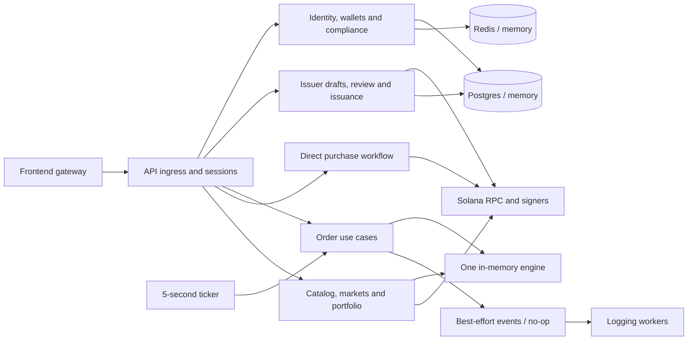

# Baseline backend flow map

Captured from the working tree on 2026-10-19, including the completed trading pilot. This is a **historical pre-refactor snapshot**, retained to review behavioral preservation. The [current ownership map](current-map.md), [HTTP register](current-routes.md) and [retirement record](retirements.md) describe the implemented result. Source paths in prose describe the baseline; route links below point to current handlers or retirement records.

## Scope and coverage

The inventory covers `rabovel-BE`: 4 executable applications, 11 library crates, 2 operator examples, 6 SQL migrations, 98 Rust source files, 63 explicit HTTP method/path registrations across 54 paths, and 10 event topics. There are 142 Rust test declarations, including 2 ignored integration tests. Axum's implicit GET/HEAD behavior and CORS OPTIONS handling are not counted as extra business endpoints.

[flow-inventory.json](flow-inventory.json) records each route's registration and handler location, every Rust source's flow assignment and test declarations, and the remaining repository paths. F01–F37 below group related operations; the HTTP register at the end still lists every method separately. Helpers, DTOs and test fixtures are supporting code, not additional independent business flows.

Method: trace merged routers to handlers, then through policy, repositories, providers, state changes and event publication; inspect all application/example entry points, public engine/chain workflows, producer/consumer wiring, migrations and operational build entry points. Source is authoritative. This is a static code map: deployed traffic, external consumers, historical database contents and actual RPC/broker availability are not established by it. Tests listed here are existing evidence and gaps, not a claim of complete coverage. No runtime changes or chain transactions were made during this mapping pass.

## Execution paths

There is currently no engine-to-chain settlement connection. Engine fills, direct purchases and issuer minting are distinct flows even where they share a ticker or an adapter.

## Shared request and state rules

- `http/router.rs` merges all feature routers. A 16 KiB body limit and configured-origin CORS apply. Observation middleware surrounds ingress handling. `/health` bypasses gateway authentication and IP rate limiting; other paths require the configured gateway secret and validated client IP. Without a secret, local mode uses the socket peer and ignores forwarded IP headers. The IP limit is 60 requests / 60 seconds.
- `AuthenticatedUser` resolves bearer-token hash through the ephemeral session store; session records carry user ID and optional MFA verification time. Current user/principal records are fetched for financial access checks. Issuing a session generates a random token, stores only its hash and applies a 900-second TTL.
- Financial authorization currently delegates through `features/trading/adapters/access.rs`, using the current user, first linked wallet, role, permission, onboarding policy and MFA freshness. Some operations additionally use a 10 requests / 60 seconds user/session limiter. Do not assume every authenticated route has that limiter or the same authorization gate.
- HTTP error mapping retains typed policy statuses/codes; dependency failures are redacted to a generic response. Observation records metadata, request IDs and safe headers. Successful provider-status payloads also redact internal provider errors.
- `GatewayStateBuilder` defaults to in-memory repositories/session/limits, disabled Google, SIWE wallet proof, mock KYC, disabled metadata/chain/payment adapters, no-op events, unified catalog, simulated prices and one engine. Hosted startup imposes stronger requirements (F30). Test/default composition does not start the production ticker.
- Event publication described below is best-effort and occurs after state changes. A failed publication does not roll back the database or engine. No transactional outbox exists.

## HTTP-triggered workflows

### F01 — Password accounts (H06–H07)

Registration validates and normalizes name/email/password, accepts only public investor/issuer account choices, assigns Trader/Issuer server-side, accepts demo terms, derives permissions, Argon2-hashes with a random salt, atomically creates user and credential, then issues a session. Login looks up the normalized email credential, verifies the password, loads the current user and issues a session. Session creation can fail after a user has been committed; this is not one transaction across Postgres and Redis. Public inputs cannot choose privileged roles.

Source: root `password_register_handler`, `password_login_handler`, `GatewayState::password_session`, `identity::Repository`, Postgres `create_password_user`; domain profile/principal policy. Target: `identity/accounts/passwords` with local credential repositories and password provider. Preserve current errors, role assignment and transaction. Evidence: password tests in root API, all three `authorization_tests.rs` regressions, ignored migration test. Add repository parity/duplicate-email tests during extraction where coverage is absent.

### F02 — Session lifecycle and current account (H04–H05)

Authentication hashes the bearer token and looks up an unexpired session. `/auth/me` reads current user/credential, chooses a display name and returns current roles/status. Logout deletes the session hash. Missing, expired and revoked sessions fail authentication; unavailable security storage fails closed. There is no refresh-token or public MFA enrollment/verification endpoint.

Target: `identity/sessions`; bearer extraction stays in API `http/authentication.rs`, while issuing/resolving/revoking sessions is transport-independent. Preserve TTL/key encoding and existing Redis sessions across deployment. Evidence: live/expired-session, logout and security-store-unavailable tests.

### F03 — Google OIDC, selected for retirement (H02–H03)

Start calls provider `begin` and stores nonce/PKCE pending state for 300 seconds. Callback rejects reused state, atomically takes pending state, marks it used before exchanging the code, validates provider claims, gets/creates the identity-linked user, applies trusted internal role assignments and issues a session. The production env builder leaves Google disabled; the real discovery/exchange adapter is available but unwired. Tests use `FakeGoogle` extensively.

Retire routes/provider/state wiring after migrating fixtures and establishing external/account compatibility. Keep persisted Google identity discriminants/records until a data decision permits removal. Frontend password auth is active; its gateway already rejects Google start. Evidence: OIDC replay, unverified claims, client role-injection and trusted-role tests. These tests' policy assertions must survive fixture replacement.

### F04 — Authorization decisions (H53 and financial callers)

Explicit wallet authorization rate-limits the user, loads current user and requested wallet, then evaluates owner, role, permission, onboarding and fresh MFA requirements. Order/portfolio/purchase authorization currently chooses the first linked wallet through the shared helper; the Solana journey separately resolves a linked Solana wallet. These selections are not interchangeable. Policy also defines sensitive actions that have no execution endpoint here (for example withdrawal authorization).

Target: `identity/access` with narrow account/wallet queries and one public authorization facade. Evidence: domain role/onboarding/MFA/cross-user tests, API forged-principal/session tests and trading access tests. Do not introduce a second policy in a handler, repository or consumer.

### F05 — Onboarding and terms (H37–H38)

Status reads the current profile and computes onboarding through the security policy. Accepting a terms version mutates/saves the profile, recomputes status and publishes `OnboardingStatusChanged` only on a transition. Password signup, verified wallet linking and KYC verdicts also affect onboarding. Demo policy and strict policy have different requirements; preserve that choice at composition.

Target: `compliance/onboarding`, calling an identity-owned profile-update facade; do not duplicate the user aggregate or let compliance replace roles accidentally. Evidence: KYC lifecycle and domain onboarding tests. Terms validation, no-transition behavior and storage failures need focused characterization when moved.

### F06 — Wallet ownership proofs and linked wallets (H50–H52, H54)

EVM challenge validates supported chain/provider/address and creates SIWE domain/URI/nonce/time-bound text. Solana challenge validates a base58 Ed25519 key and creates equivalent origin-bound signing text. Both store a session-user-bound challenge for 300 seconds. Linking checks replay, consumes the challenge, marks it used **before** comparing the session user and verifying the signature, then inserts the verified wallet, updates the user profile, publishes `WalletLinked` and any onboarding transition. Invalid proof can therefore consume a challenge. Listing is user-scoped. Solana resolution selects a linked Solana/Phantom wallet and validates ownership.

Target: `identity/wallets/{linking,queries}`, with feature-local challenge store and SIWE/Solana proof providers. Keep Redis GETDEL and current replay/error ordering. Wallet insertion/profile update/event publication are separate effects today; specify atomicity improvements separately. Evidence: session-bound/single-use challenge, Phantom verification/persistence/listing, real SIWE recovery and forged-wallet tests.

### F07 — KYC submission, callback and sandbox (H35–H36, H61)

Submit applies the user limiter, verifies the session user exists, sends a document **reference** to the provider, persists the returned case and publishes `KycCaseSubmitted`. The mock keeps case data in process memory. Callback verifies HMAC against untouched body bytes, loads the case and validates its user, applies verified evidence to the current profile while preserving MFA/device fields, saves user, finalizes case, publishes `KycVerdictReceived` and any onboarding change. User update and case finalization are separate writes. There is no durable webhook inbox or monotonic verdict/replay policy.

Sandbox advance obtains a mock-generated signed payload and calls the same callback. It is registered only in debug builds without a gateway secret. `ZZ` produces a rejected/high-risk verdict; other countries approve. Mock cases do not recover across process restarts even when case rows are durable. Target: `compliance/kyc/{cases,verdicts,sandbox}` in existing `kyc`; provider implementations remain local. Evidence: API lifecycle plus four provider tests. Add duplicate/stale-verdict and partial-write characterization before changing callback semantics.

### F08 — Issuer organization onboarding (H17–H18)

Issuer role is required. Overview returns organization status or pending when absent. Onboarding validates organization fields/attestations, immediately records a demo approval and upserts the organization. `require_approved_issuer` means Issuer role plus a recorded organization; there is no implemented external KYB review.

Target: `issuer/organizations`; narrow organization repository, shared issuer-access facade. Evidence: trusted-role, public-role and approved-issuer API tests. Label the mock approval honestly when splitting it.

### F09 — Draft lifecycle (H19–H20, H23–H25)

Approved issuers create/list/read/update/delete their own drafts. Creation/request mapping uses domain validation/normalization, canonical instrument identity and NGX ticker collision checks. Persistence enforces canonical uniqueness and status constraints; update/delete depend on current ownership and lifecycle. Cross-user lookup must preserve current response/error behavior. Asset records include metadata, backing/listing fields and later mint address.

Target: `issuer/assets/drafts`; local `models.rs`, `usecases.rs`, `ports.rs`, `repositories/{postgres,memory}.rs`. Preserve SQL guards/uniqueness and memory behavior. Evidence: domain asset validation, draft integration and cross-issuer authorization tests; add update/delete/status-conflict characterization where missing.

### F10 — Asset images and hosted metadata (H21–H22; F11 uses publishing)

Image upload request checks issuer ownership/draft state, supported PNG/JPEG/WebP and 1-byte–5-MB size, then generates an asset-scoped random object path and signed Supabase upload URL. Browser uploads bytes directly. Confirmation checks the owned path prefix and expected MIME, HEAD-verifies the public object/type/size and saves its URI. Review separately publishes constructed asset/organization JSON to hosted metadata storage. Disabled and memory providers are used in local/test composition.

Target: `issuer/assets/media` and `issuer/assets/metadata`, sharing a storage implementation where useful. Storage effects and database updates cannot be assumed atomic; retain retry/object-path semantics. Existing large issuer test covers a happy journey; no complete network Supabase integration coverage is established.

### F11 — Demo review and backing evidence (H26, H31)

Review verifies ownership, publishes metadata when missing, saves its URI and marks the asset approved for setup through guarded repository behavior. Backing submission validates the supplied document metadata/evidence values and records it as verified immediately under demo rules; it does not upload or independently verify a backing document. These are two distinct subfeatures even though both currently approve immediately.

Target: `issuer/assets/{review,backing}`. Keep publication, lifecycle and backing policy separate so real review providers can be added later. Preserve active routes during legacy-tokenization retirement. Evidence: domain validation and issuer journey; future real review requires new states/contracts rather than renaming this demo behavior.

### F12 — Mint setup operation (H27–H28)

Owner-only read/start requires approved-for-setup or minted asset, hosted metadata and configured executor. Create one operation per asset, deriving its replay-stable mint key from operation ID and secret. Existing non-failed operations are returned without re-execution; failed ones reset to running. The provider creates/verifies shared lists, mint and ACL setup. On success the API saves a confirmed operation and then separately marks the asset minted. On error it saves failed or reconciliation-required status using the provider's current string-based ambiguity classification.

The low-level ACL service verifies stages; the API does not durably checkpoint every submitted stage/signature as it happens. A crash can leave `running`, and a failure between operation confirmation and asset update leaves inconsistent rows. Do not claim automatic recovery. Target: `issuer/assets/issuance/setup`; local setup repository and issuance provider port. Preserve uniqueness, key derivation domain/version, authorities and stage order. Evidence: issuer journey, extensive low-level ACL tests; API crash/concurrent-retry/recovery behavior lacks complete coverage.

### F13 — Initial inventory (H29–H30)

Owner and confirmed setup are required. GET reads issuer settlement ATA, allowlist, readiness, supply and inventory. POST returns existing completed issuance when supply equals authorized units; conflicting nonzero supply/inventory fails. Otherwise it adds issuer eligibility if absent, creates ATA if absent, thaws with ACL, verifies readiness, mints the authorized whole-unit supply and reads back. Completed issuance depends on **total supply**, so inventory sold later does not undo issuance. A balance-RPC error in `inventory_snapshot` currently falls back to zero; other reads can fail.

Target: `issuer/assets/issuance/inventory`; separate read/issue use cases, shared chain primitives. No separate durable issuance journal exists. Evidence: issuer happy path and builder/ACL tests; ambiguous mint completion and retry/race scenarios need provider-level characterization.

### F14 — Listing publication (H32)

Owner/approved issuer submits publication after verified backing, acceptable non-colliding ticker and completed inventory. Repository updates listing state. Unified catalog then discovers the live minted record without another registration step. Ticker prechecks and publish are not a single database-wide reservation protocol.

Target: `issuer/assets/listings`; export a published-listing query facade to catalog/purchases. Preserve stable IDs and current discovery filters. Evidence: issuer journey and automatic-catalog-join tests; race-safe cross-issuer ticker reservation is a separate correctness upgrade.

### F15 — Broker cNGN account (H33–H34)

Authenticated GET returns configured mint/network/token-program/decimals and broker ATA readiness. POST requires approved issuer and ensures the broker ATA using configured fee payer. Provider inspects supported token-program ownership and account identities; disabled/configuration/read failures are represented through existing status/error contracts. Account creation is an external effect without a local operation ledger.

Target: `payments/cngn/broker_accounts` inside the API initially. Shared chain utilities may stay in `solana-adapter`; broker readiness is a payment capability, not an issuer repository. Evidence: issuer journey/provider fakes and safe-status-error tests; real RPC integration remains opt-in.

### F16 — Investor cNGN account (H55–H56)

Resolve current user's linked Solana wallet; read its cNGN ATA balance/readiness. POST additionally applies the session limiter and ensures ATA with server fee payer. The user does not supply an arbitrary owner. Target: `payments/cngn/wallet_accounts`; expose a narrow balance/account facade for direct purchases and portfolio through composition. Evidence: linked-wallet and issuer/purchase journey fakes; add owner/account/RPC failure coverage when moved.

### F17 — Unified instrument catalog (H08 and internal lookups)

Combine 146 simulated NGX fixtures with minted issuer assets whose listing is live and ticker valid/non-NGX/nonduplicate. Produce stable market/asset IDs and instrument origin. Resolve ticker case-insensitively. `CatalogReferencePrices` only prices instruments that resolve in this catalog. Catalog remains marked simulated; fixtures are active functionality, not stale files to delete.

Target: `catalog/instruments`, with `providers/ngx_simulated.rs`, a published-issuer query and focused ID resolver. Extract the fixture data from behavior. Evidence: fixture count/ID/ticker tests, live-issuer join and unknown-symbol pricing tests.

### F18 — Markets, assets and chart views (H09–H16)

These reads have ingress protection but no bearer extractor. Market list/detail combines catalog, simulated reference price, house-spread arithmetic and recent engine tape for 24-hour volume/high/low. Book reads aggregate the shared engine's client depth plus fresh house quote/capacity; trades expose anonymous tape. Price history samples deterministic ticker/time prices and adds observed engine trade volume. Asset list/detail maps the same instruments and NAV history samples the same price path. Query limits/ranges and response envelopes live in existing handlers/helpers.

Target: `market_data/{markets,assets,charts,prices}`. Move deterministic math with its tests; keep display parsing separate from exact execution decimal parsing. Market advertised bid/ask is computed independently of book risk capacity, and tape holds only 1,000 recent trades/symbol: neither is a durable market history. Evidence: API view-envelope tests, candle/fixed-point and price-feed tests. No real exchange pricing integration exists.

### F19 — Purchasable asset catalog (H44; also portfolio dependency)

Authenticated read resolves linked Solana wallet and payment account, lists minted assets, filters live/verified-backed/confirmed-setup/issued inventory, reads investor positions and returns payment/asset readiness and prices. It makes multiple RPC calls; eligibility filtering is distinct from the public instrument catalog. Target: `settlement/direct_purchases/catalog`, consuming issuer listing, payments and wallet queries through narrow ports. Evidence: issuer journey/catalog and merged portfolio tests; RPC outage/filter boundaries need dedicated tests.

### F20 — Direct purchase/sell quotes (H45)

Requires TradeSpot access, positive integer quantity, linked Solana wallet, cNGN state and a minted issuer asset with confirmed setup/completed inventory. Unlike F19, this handler does not explicitly require live listing or verified backing; preparation separately checks live listing. Buy checks inventory and funds including fee. Sell checks investor equity readiness/balance and uses demo discounted bid arithmetic; **there is no corresponding sell settlement endpoint**. Fees/expiry are read from environment per request today. Quote IDs/times are returned but not persisted, reserved or enforced as an accepted-quote record. Buy arithmetic has checked overflow errors, while some response/sell arithmetic falls back to zero or uses unchecked operations; characterize those boundaries before changing them.

Target: `settlement/direct_purchases/quotes` with injected typed configuration and price/payment/position queries. Preserve arithmetic/errors in extraction; startup validation timing must be called out as a separate change. Add direct quote boundary/overflow/balance tests: broader API envelope tests do not prove these semantics.

### F21 — Purchase preparation has chain effects (H46)

Creates a **fresh buy quote** from asset/quantity, reloads wallet/asset/setup/payment readiness and resolves payment token program. Provider may add investor to allowlist, create equity ATA and thaw it using admin transactions **before returning**. It then builds one transaction containing investor cNGN payment plus issuer equity transfer with extra metas, partially signs as issuer and returns base64 plus fresh quote for investor signing. The final transaction's fee payer is the investor; preparatory transactions use admin.

Target: `settlement/direct_purchases/preparation`; distinguish prerequisite effects from transaction construction. There is no durable prepared-intent record or binding to a previously returned quote ID. Evidence: underlying chain builder/ACL tests, but no complete prepare HTTP/RPC/signature journey test. Characterize this before moving effect boundaries.

### F22 — Purchase submission (H47)

Requires TradeSpot, resolves linked wallet, decodes base64, deserializes transaction, checks first account/fee payer matches the wallet, verifies signatures, sends and confirms through RPC. Returns confirmed signature; ambiguous/unconfirmed RPC errors map to conflict, other provider errors to unavailable (HTTP boundary redacts dependency messages). **The current implementation does not compare instructions/amounts to a persisted server preparation or quote.** No purchase journal, idempotency key, confirmation worker or operation-status lookup exists.

Target: `settlement/direct_purchases/submission`, preserving existing behavior during extraction. Binding submission to durable intent, expiry and expected message is an explicit behavioral upgrade with failure/recovery tests, not an assertion that signature verification already provides it. Existing low-level tests do not establish end-to-end purchase recovery.

### F23 — Place order (H57)

Order use case applies current user limiter before TradeSpot authorization. Engine service normalizes ticker, parses whole quantity/fixed-point price, resolves current catalog price, checks freshness, takes one mutex, reprices existing limits first and then submits the new order. It records statuses/self-trade cancellations/fills/net balances and anonymous tape. It publishes OrderAccepted before all returned TradeExecuted records, returning a counterparty-free acknowledgement even on event delivery failure. It checks neither actual buying power nor token balance.

Important current edge: repricing can mutate resting orders before the new submission rejects; the error path does not return those trades for event publication. Engine counters/state/balances vanish on restart. Target: `trading/orders/placement`, engine integration under `trading/execution`; durable mutation capture is a later behavior change. Evidence: pilot use-case/HTTP/error/privacy tests and engine suite. Keep the single engine shared with views and ticker.

### F24 — Order queries (H58–H59)

ViewPortfolio authorization precedes user-scoped list/get. Lists newest first. Missing, malformed or other-owner IDs are hidden through current not-found behavior. Target: `trading/orders/queries`; keep execution facts private. Evidence: engine-service ordering and pilot cross-user query tests.

### F25 — Cancellation (H60)

TradeSpot access, then owner-scoped engine cancellation and status update; no additional place-order limiter, cancellation event or durable release record today. Available/locked balances are calculated from remaining open orders, not durable reservations. Target: `trading/orders/cancellation`. Evidence: engine owner checks, locked-balance and pilot action/ownership tests. Preserve terminal-order errors.

### F26 — Automatic repricing (non-HTTP trigger)

Production bootstrap spawns an immediate tick and then ticks every 5 seconds, skipping missed ticks. Reusable repricing scans symbols with resting orders, loads current catalog prices, ignores missing/stale quotes, updates shared engine and publishes all returned fills without a user authorization step or OrderAccepted event. It fetches prices for all symbols before taking the mutation lock; a price-source failure aborts that tick before repricing begins. No managed shutdown/checkpoint/recovery exists for this task.

Target: `trading/repricing/{usecases,jobs}.rs`; app owns spawning/lifecycle, feature owns behavior. Evidence: immediate-ticker real-engine test, reprice/event-failure use-case tests and engine repricing/sequence tests. Durable design must cover partial progress and all mutation entry points.

### F27 — Portfolio balances and views (H39–H43)

All require ViewPortfolio access. `/portfolio` returns engine-only net balances and computed open-order locks. Rich views combine positive engine positions/order-derived average cost with confirmed wallet holdings discovered through F19, merging same asset rows and counting wallet cNGN cash once. Wallet holding cost uses a current-price estimate; engine cash deltas are not added to rich-view wallet cash. Missing wallet can produce no chain contribution; dependency failures propagate instead of presenting an unavailable balance as verified zero.

Summary/holdings value current positions; performance reprices current holdings across historical simulated prices rather than reconstructing historical account returns. Activity is order-derived, not a complete cash/settlement ledger. Target: `portfolio/{balances,valuation,performance,activity}` in existing `portfolio-trading`. Consume order, catalog, wallet/payment/position queries through ports. Evidence: merged-row/cash and envelope tests, engine locks/balance tests. Preserve the current distinction before adding source-aware durable projections.

### F28 — Legacy tokenization requests, selected for retirement (H48–H49)

POST applies the limiter, authorizes a financial action and publishes `TokenizationRequested` with a random request ID, returning accepted. GET authenticates and always reports pending without persisted request lookup/ownership correlation. The worker logs requests; no completion publisher exists. This is separate from implemented issuer setup/inventory.

Retire API routes/DTOs/producer and frontend gateway allowlist, then unused tokenization worker/constant library. Keep event compatibility until consumer obligations are established. No UI caller was found, but frontend gateway currently permits these paths; external clients remain unknown. Evidence: source registrations and consumer search, not proof of no deployed users.

### F29 — Health and development documentation (H01, H62–H63)

Health returns static `ok`; it is liveness, not dependency readiness. Swagger HTML and OpenAPI JSON are compiled/registered only with debug assertions and no gateway secret; generated schema entries must stay aligned when retiring/moving handlers. Target: app health plus development-doc HTTP wiring. Evidence: health, CORS/fail-closed and ingress tests. Do not silently expose debug routes or change `/health` into a dependency gate.

## Process, library and operational workflows

### F30 — Startup, composition, ingress and configuration

`main` builds `router_from_env`, parses bind address (`RABOVEL_BIND_ADDR`, then `PORT`, then 0.0.0.0:8080), binds listener and serves with socket connection info. Deployment validates public origin/profile before migrations/external writes. Hosted `public-devnet` requires demo=true, remote Postgres/Redis/Supabase/RPC, devnet, gateway secret, signers/derivation secret/payment mint, Kafka unset; RPC genesis is verified before migrations. Local fallback is explicit through a local origin. Server-level invalid configuration can currently be detected after router construction.

Composition attaches Postgres/migrations when configured, Redis security state/limits, optional Kafka producer, paired Supabase URL/secret, all-or-none Solana setup/signer settings, payment RPC/network/mint settings, mock KYC secret (random if absent), typed trading config, catalog/reference prices and shared engine; then starts F26. Google remains disabled. Payment and setup env groups overlap, so their effective requirements must be preserved together.

Configuration groups: deployment/public origin/gateway; bind/PORT; DB/Redis; Kafka/worker RUST_LOG; Supabase; Solana RPC/network/admin/broker/issuer/derivation; cNGN mint; KYC secret; demo policy; house spread/position/mint limits/float and max price age; request-time quote fee/expiry. `.env` values and private signing files were not read for this inventory. Target: `app/{config,bootstrap,lifecycle}` with typed feature config. Evidence: deployment, ingress, config, observability and fail-closed tests; full release build previously passed.

### F31 — Worker entry points and reserved business boundaries

All three workers initialize tracing, parse broker list (localhost:9092 fallback), spawn one logging task per subscription and wait for tasks while discarding join results. Settlement subscribes to TradeExecuted and TokenizationCompleted; reconciliation subscribes to TradeExecuted, PortfolioChanged and TokenizationCompleted; tokenization subscribes to TokenizationRequested. The three companion libraries contain only `SERVICE_NAME` constants.

No worker executes settlement, repairs discrepancies, projects portfolios or issues assets. Keep settlement/reconciliation process shells explicitly labelled; remove constant-only dependency wrappers. Reuse `settlement-orchestrator` for **real extracted direct-purchase behavior**, rather than creating another empty package. Remove tokenization process with F28 after compatibility checks. Reconciliation gets a business library only when implemented behavior needs one; do not keep an empty crate for symmetry.

### F32 — Event contracts, production and consumption

`events` owns payloads/topics/envelope/errors with no broker dependency. `publish` creates a fresh random event ID/timestamp and serializes an envelope; Kafka sends partition 0 keyed by event ID. No-op/in-memory producers are composition/testing alternatives. Delivery failure is not durable. `TopicConsumer` supports supplied start offset but worker logger uses Earliest, partition 0, unknown-topic retry. `next_event` drops the Kafka offset from its returned API. Logger skips malformed records, stops on stream end, returns on connection failure; no consumer group, stored checkpoint, retry/dead-letter policy or durable inbox exists. Envelope decode checks event type but currently does not enforce schema version.

| Topic suffix (all prefixed `rabovel.` and suffixed `.v1`) | Live producer | Registered consumers | Handling decision |
| --- | --- | --- | --- |
| `onboarding.status-changed` | Terms, wallet/KYC onboarding transitions | None | Preserve; stable delivery is a future upgrade |
| `wallet.linked` | Wallet link | None | Preserve |
| `kyc.case-submitted` | KYC submit | None | Preserve |
| `kyc.verdict-received` | KYC callback | None | Preserve |
| `trading.order-accepted` | Order placement | None | Preserve current ordering; future outbox |
| `trading.trade-executed` | Placement and ticker | Settlement and reconciliation loggers | Preserve; durable consumers require inbox/checkpoint |
| `portfolio.changed` | None | Reconciliation logger | Reserved contract; do not claim active projection |
| `tokenization.requested` | Legacy endpoint | Tokenization logger | Retire with F28 |
| `tokenization.completed` | None | Settlement and reconciliation loggers | Retire legacy subscriptions after compatibility review |
| `tokenization.failed` | None | None | Reserved legacy contract; same compatibility review |

Target: feature producer mapping beside its workflow; feature consumers beside receiving use cases; reusable Kafka/encoding transport in `infrastructure`, integration payloads in `events`. Evidence: envelope roundtrip/type mismatch, in-memory producer, broker-list parser tests. Broker delivery/restart tests are not currently established.

### F33 — Solana library operations

- Authority configuration loads file/secret-byte sources, validates admin/broker/issuer roles and supports shared keys with distinct roles. Deployment config creates/saves non-overwritten public ACL seeds and derives shared-list plans. Keep signer material outside business models/logs.
- Mint builder validates metadata/authorities/space and builds Token-2022 creation/metadata instructions: zero initial supply, zero decimals, frozen default accounts, inactive transfer hook, no permanent delegate. `EquitySetupService` submits or verifies an existing mint, and exposes ACL handover planning. These are actual library entry points even when an API does not call every method.
- SharedListsService creates missing allow/block lists and verifies existing identity/content; preserves public seeds and reuse across mints.
- MintAclService configures handover, extra-account metadata, gate setup and thaw enablement with confirmed readback between stages. Conflicting/malformed state or uncertain transaction stops execution rather than blindly retrying. Low-level result/error carries signatures, but upper API error mapping does not persist all that detail.

Target: retain `solana-adapter` as tested SDK/RPC primitives, normalize PascalCase paths to snake_case in one coordinated change. Business decisions and durable operation orchestration stay in issuer/settlement. Evidence: builder, signer/config/list/ACL tests and ignored local-validator mint test. Do not merge the builder's authority roles with application user roles.

### F34 — Operator CLI/example flows

`create_equity_mint <authorities> <issuer-id> <mint-keypair> <metadata>` targets localhost validator, loads signers/metadata, creates and verifies the zero-supply mint and prints public result. `setup_shared_lists init` writes new public seed config without a transaction; `create` uses that config to create-or-verify lists on localhost. Keep both examples/runbooks compiling and preserve opt-in mutation; mapping/build checks do not execute them. These files are not unused merely because API code does not import examples.

### F35 — Database migration, build and deployment operations

Startup embeds/applies six SQL migrations: initial user/identity/wallet/KYC tables; password credentials; issuer organizations; asset drafts/uniqueness; setup operations/mint lifecycle; restricted password roles. Preserve applied migration history/checksums. The role migration intentionally retains OIDC history and Issuer role while stripping legacy password privileges.

`cargo server` runs Cargo Watch sourcing local env on host. Compose supplies Postgres/Redis (25 MB/noeviction) plus opt-in Rust test container. The dev override adds a bare API service lacking complete current configuration/network wiring: repair or retire explicitly. Docker builds and ships **only API**. Nested backend GitHub workflow declares fmt, Clippy, workspace tests and Docker build with Rust 1.98; this checkout's actual Git root is the parent `rabovel-demo`, so nested workflow discovery/build contexts must be corrected before assuming enforcement. Test container/Docker/CI toolchains should stay aligned.

Docs/demo plans include historical and active operational content. Keep current authority decisions, metadata/config examples and active 03–05 runbooks; archive superseded 01–02 decisions/import-era status with link repair. Tracked keypair filenames require externalization/rotation coordination; contents were not inspected. Do not rewrite history as part of structural cleanup.

### F36 — Matching and house inventory library workflows

`MatchingEngine::submit` applies quantity/price limits, price-time client priority, equal-price client preference over house, house spread/risk capacity, partial market fills/remainder cancellation, limit resting and self-trade cancellation. `reprice` matches eligible resting limits to fresh house quotes. `cancel` checks ownership. Read operations expose per-user open orders, aggregate depth, resting symbols, configured limits, house position and quote capacity.

House bookkeeping tracks signed principal position, treasury float and unbacked minted delivery: sales consume float then permitted mint capacity; purchases retire unbacked mints before refilling float. `fund_float`, `close_hedge_window` and `settle_hedge` expose funding/netting/hedge accounting. API startup uses configured float; periodic hedge close/real hedge settlement are **not wired** to a scheduler or chain worker. These remain library capabilities. Sequence/IDs are in memory.

Target: retain independent `matching-engine`, grouped `orders`, `book` and `house` only when size warrants; no DB/RPC/HTTP dependencies. Evidence: all 20 matching tests, including liquidity priority, float/mint, hedges, sequence, owner and stale-reference service tests.

### F37 — Persistence and technical state implementations

| Current contract/state | Current implementation and atomicity | Feature ownership / migration constraint |
| --- | --- | --- |
| User/credential/identity records | Memory + broad PgRepository; password creation and identity get/create use DB transactions | Identity account repository; keep credential+user atomic and identity uniqueness |
| Profile/principal updates | Whole user save/upsert, including compliance, roles and terms | Identity owns user aggregate; compliance uses explicit updates so splitting ports does not cause lost fields |
| Wallet connections | User-scoped reads, uniqueness/ownership persistence; link plus profile save are separate effects | Identity wallet repository; preserve proof and replay semantics |
| KYC case records | Create/finalize/get, separate from profile update | KYC case repository, explicit profile update facade |
| Issuer organization | User-owned upsert/query | Issuer organization repository |
| Draft/backing/listing | Guarded SQL updates, canonical-key uniqueness, serialized draft fields | Issuer asset subfeatures; share transaction/pool where invariant requires it |
| Setup operation | Unique per asset; create-or-return winner; separate operation and minted-asset saves | Issuer issuance repository; no naive generic CRUD replacement |
| Sessions and proof state | Memory TTL maps / Redis JSON SETEX; challenge/pending retrieval is atomic GETDEL; used markers separate | Split consumer-owned session and wallet challenge ports; OIDC methods retire |
| Rate limits | Memory fixed window versus Redis Lua token bucket | Preserve existing configured behavior during moves; do not assert algorithm parity |
| Metadata/images | Disabled, memory and Supabase implementations | Issuer media/metadata providers; technical HTTP client can be shared |
| Engine/orders/net balances/tape | One mutex-owned process state; 1,000-trade tape cap; no DB recovery | Trading execution; portfolio consumes queries |

All 29 broad `identity::Repository` methods have an owner above: 3 credential, 2 organization, 11 draft/media/review/backing/listing, 4 setup/mint, 3 user/identity, 3 wallet and 3 KYC operations. Narrow contracts must express workflow atomicity, not just copy these methods into folder-shaped CRUD interfaces. Memory and real adapters need consistent required invariants; existing intentional algorithm differences remain explicit.

## Source coverage and verification handoff

The JSON source register assigns all 98 `.rs` files, including module declarations, HTTP DTOs, supporting fakes, examples, workers and constant-only crates. Its `other_paths` covers manifests/lockfile, migrations, build/Compose/CI configuration, skills, docs, examples and signing-artifact paths. Root `lib.rs`, the broad repository, combined chain executor and shared view helpers deliberately map to multiple flows; they are extraction sources, not target owners. Source counts exclude ignored/generated `target` output and secret environment files.

Existing coverage is strongest in matching/policy/ACL invariants, weaker in high-level purchase, issuance failure/retry, real SQL/Redis equivalence and durable messaging. Baseline from the previous pilot: 140 tests passed, 2 ignored; workspace Clippy and release API build passed; workspace formatting has an existing unchanged array-layout failure in `crates/domain/src/assets.rs:238`. This planning pass checks inventory/link/coverage consistency; it does not rerun runtime tests or claim the ignored infrastructure tests passed.

Implementation must maintain the route register and update source assignments as files move. A flow is not complete merely because a directory exists: its handler/use case, policy, persistence/provider implementations, events, configuration, tests and docs must all have a destination or an explicit retirement record.

## Complete HTTP register

Registration locations and availability are machine-recorded in [flow-inventory.json](flow-inventory.json); handler links below point at this captured working tree. F03 and F28 remain registered until the deprecation/removal checkpoint. Debug-only paths are excluded from release.

| ID | Method / path | Handler | Flow | Registration |
| --- | --- | --- | --- | --- |
| H01 | `GET /health` | [`health_handler`](../../apps/rabovel-api/src/app/health.rs#L6) | F29 | active |
| H02 | `GET /auth/google/start` | [Retired](retirements.md) | F03 | retire |
| H03 | `POST /auth/google/callback` | [Retired](retirements.md) | F03 | retire |
| H04 | `GET /auth/me` | [`auth_me_handler`](../../apps/rabovel-api/src/features/identity/sessions/handlers.rs#L10) | F02 | active |
| H05 | `POST /auth/logout` | [`logout_handler`](../../apps/rabovel-api/src/features/identity/sessions/handlers.rs#L18) | F02 | active |
| H06 | `POST /auth/register` | [`password_register_handler`](../../apps/rabovel-api/src/features/identity/accounts/handlers.rs#L9) | F01 | active |
| H07 | `POST /auth/login` | [`password_login_handler`](../../apps/rabovel-api/src/features/identity/accounts/handlers.rs#L19) | F01 | active |
| H08 | `GET /instruments` | [`instruments_handler`](../../apps/rabovel-api/src/features/catalog/instruments/handlers.rs#L7) | F17 | active |
| H09 | `GET /markets` | [`list_markets_handler`](../../apps/rabovel-api/src/features/market_data/markets/handlers.rs#L12) | F18 | active |
| H10 | `GET /markets/:market_id` | [`get_market_handler`](../../apps/rabovel-api/src/features/market_data/markets/handlers.rs#L19) | F18 | active |
| H11 | `GET /markets/:market_id/order-book` | [`market_order_book_handler`](../../apps/rabovel-api/src/features/market_data/markets/handlers.rs#L26) | F18 | active |
| H12 | `GET /markets/:market_id/price-history` | [`market_price_history_handler`](../../apps/rabovel-api/src/features/market_data/charts/handlers.rs#L11) | F18 | active |
| H13 | `GET /markets/:market_id/trades` | [`market_trades_handler`](../../apps/rabovel-api/src/features/market_data/markets/handlers.rs#L35) | F18 | active |
| H14 | `GET /assets` | [`list_assets_handler`](../../apps/rabovel-api/src/features/market_data/assets/handlers.rs#L9) | F18 | active |
| H15 | `GET /assets/:asset_id` | [`get_asset_handler`](../../apps/rabovel-api/src/features/market_data/assets/handlers.rs#L17) | F18 | active |
| H16 | `GET /assets/:asset_id/nav-history` | [`asset_nav_history_handler`](../../apps/rabovel-api/src/features/market_data/charts/handlers.rs#L21) | F18 | active |
| H17 | `GET /issuer/overview` | [`issuer_overview_handler`](../../apps/rabovel-api/src/features/issuer/organizations/handlers.rs#L9) | F08 | active |
| H18 | `POST /issuer/onboarding` | [`issuer_onboarding_handler`](../../apps/rabovel-api/src/features/issuer/organizations/handlers.rs#L17) | F08 | active |
| H19 | `GET /issuer/assets` | [`list_asset_drafts_handler`](../../apps/rabovel-api/src/features/issuer/assets/drafts/handlers.rs#L22) | F09 | active |
| H20 | `POST /issuer/assets` | [`create_asset_draft_handler`](../../apps/rabovel-api/src/features/issuer/assets/drafts/handlers.rs#L11) | F09 | active |
| H21 | `POST /issuer/assets/:asset_id/image-upload` | [`create_asset_image_upload_handler`](../../apps/rabovel-api/src/features/issuer/assets/media/handlers.rs#L11) | F10 | active |
| H22 | `POST /issuer/assets/:asset_id/image-upload/confirm` | [`confirm_asset_image_upload_handler`](../../apps/rabovel-api/src/features/issuer/assets/media/handlers.rs#L22) | F10 | active |
| H23 | `GET /issuer/assets/:asset_id` | [`get_asset_draft_handler`](../../apps/rabovel-api/src/features/issuer/assets/drafts/handlers.rs#L32) | F09 | active |
| H24 | `PATCH /issuer/assets/:asset_id` | [`update_asset_draft_handler`](../../apps/rabovel-api/src/features/issuer/assets/drafts/handlers.rs#L43) | F09 | active |
| H25 | `DELETE /issuer/assets/:asset_id` | [`delete_asset_draft_handler`](../../apps/rabovel-api/src/features/issuer/assets/drafts/handlers.rs#L55) | F09 | active |
| H26 | `POST /issuer/assets/:asset_id/submit` | [`submit_asset_for_demo_review_handler`](../../apps/rabovel-api/src/features/issuer/assets/review/handlers.rs#L9) | F11 | active |
| H27 | `GET /issuer/assets/:asset_id/setup` | [`get_asset_setup_operation_handler`](../../apps/rabovel-api/src/features/issuer/assets/issuance/setup/handlers.rs#L9) | F12 | active |
| H28 | `POST /issuer/assets/:asset_id/setup` | [`start_asset_setup_handler`](../../apps/rabovel-api/src/features/issuer/assets/issuance/setup/handlers.rs#L20) | F12 | active |
| H29 | `GET /issuer/assets/:asset_id/inventory` | [`get_initial_inventory_handler`](../../apps/rabovel-api/src/features/issuer/assets/issuance/inventory/handlers.rs#L9) | F13 | active |
| H30 | `POST /issuer/assets/:asset_id/inventory` | [`issue_initial_inventory_handler`](../../apps/rabovel-api/src/features/issuer/assets/issuance/inventory/handlers.rs#L20) | F13 | active |
| H31 | `POST /issuer/assets/:asset_id/backing` | [`submit_asset_backing_handler`](../../apps/rabovel-api/src/features/issuer/assets/backing/handlers.rs#L10) | F11 | active |
| H32 | `POST /issuer/assets/:asset_id/listing` | [`publish_asset_listing_handler`](../../apps/rabovel-api/src/features/issuer/assets/listings/handlers.rs#L9) | F14 | active |
| H33 | `GET /payment-assets/cngn` | [`cngn_payment_asset_handler`](../../apps/rabovel-api/src/features/payments/cngn/broker_accounts/handlers.rs#L8) | F15 | active |
| H34 | `POST /payment-assets/cngn` | [`create_broker_cngn_account_handler`](../../apps/rabovel-api/src/features/payments/cngn/broker_accounts/handlers.rs#L16) | F15 | active |
| H35 | `POST /kyc/cases` | [`submit_kyc_case_handler`](../../apps/rabovel-api/src/features/compliance/kyc/cases/handlers.rs#L8) | F07 | active |
| H36 | `POST /kyc/webhook` | [`kyc_webhook_handler`](../../apps/rabovel-api/src/features/compliance/kyc/verdicts/handlers.rs#L6) | F07 | active |
| H37 | `GET /onboarding/status` | [`onboarding_status_handler`](../../apps/rabovel-api/src/features/compliance/onboarding/handlers.rs#L13) | F05 | active |
| H38 | `POST /onboarding/terms` | [`accept_terms_handler`](../../apps/rabovel-api/src/features/compliance/onboarding/handlers.rs#L28) | F05 | active |
| H39 | `GET /portfolio` | [`portfolio_handler`](../../apps/rabovel-api/src/features/portfolio/balances/handlers.rs#L7) | F27 | active |
| H40 | `GET /portfolio/summary` | [`portfolio_summary_handler`](../../apps/rabovel-api/src/features/portfolio/valuation/handlers.rs#L9) | F27 | active |
| H41 | `GET /portfolio/holdings` | [`portfolio_holdings_handler`](../../apps/rabovel-api/src/features/portfolio/valuation/handlers.rs#L18) | F27 | active |
| H42 | `GET /portfolio/performance` | [`portfolio_performance_handler`](../../apps/rabovel-api/src/features/portfolio/performance/handlers.rs#L13) | F27 | active |
| H43 | `GET /portfolio/activity` | [`portfolio_activity_handler`](../../apps/rabovel-api/src/features/portfolio/activity/handlers.rs#L8) | F27 | active |
| H44 | `GET /investor/catalog` | [`investor_catalog_handler`](../../apps/rabovel-api/src/features/settlement/direct_purchases/catalog/handlers.rs#L8) | F19 | active |
| H45 | `POST /investor/quote` | [`investor_quote_handler`](../../apps/rabovel-api/src/features/settlement/direct_purchases/quotes/handlers.rs#L9) | F20 | active |
| H46 | `POST /investor/purchase/prepare` | [`prepare_investor_purchase_handler`](../../apps/rabovel-api/src/features/settlement/direct_purchases/preparation/handlers.rs#L9) | F21 | active |
| H47 | `POST /investor/purchase/submit` | [`submit_investor_purchase_handler`](../../apps/rabovel-api/src/features/settlement/direct_purchases/submission/handlers.rs#L9) | F22 | active |
| H48 | `POST /tokenization/requests` | [Retired](retirements.md) | F28 | retire |
| H49 | `GET /tokenization/requests/:request_id` | [Retired](retirements.md) | F28 | retire |
| H50 | `POST /wallet/challenges` | [`wallet_challenge_handler`](../../apps/rabovel-api/src/features/identity/wallets/linking/handlers.rs#L17) | F06 | active |
| H51 | `POST /wallet/solana/challenges` | [`solana_wallet_challenge_handler`](../../apps/rabovel-api/src/features/identity/wallets/linking/handlers.rs#L33) | F06 | active |
| H52 | `POST /wallet/link` | [`wallet_link_handler`](../../apps/rabovel-api/src/features/identity/wallets/linking/handlers.rs#L49) | F06 | active |
| H53 | `POST /wallet/authorize` | [`authorize_wallet_handler`](../../apps/rabovel-api/src/features/identity/access/handlers.rs#L14) | F04 | active |
| H54 | `GET /wallets` | [`list_wallets_handler`](../../apps/rabovel-api/src/features/identity/wallets/queries/handlers.rs#L8) | F06 | active |
| H55 | `GET /wallet/payment-assets/cngn` | [`investor_cngn_account_handler`](../../apps/rabovel-api/src/features/payments/cngn/wallet_accounts/handlers.rs#L8) | F16 | active |
| H56 | `POST /wallet/payment-assets/cngn` | [`create_investor_cngn_account_handler`](../../apps/rabovel-api/src/features/payments/cngn/wallet_accounts/handlers.rs#L18) | F16 | active |
| H57 | `POST /orders` | [`place_order`](../../apps/rabovel-api/src/features/trading/orders/handlers.rs#L12) | F23 | active |
| H58 | `GET /orders` | [`list_orders`](../../apps/rabovel-api/src/features/trading/orders/handlers.rs#L26) | F24 | active |
| H59 | `GET /orders/:order_id` | [`get_order`](../../apps/rabovel-api/src/features/trading/orders/handlers.rs#L19) | F24 | active |
| H60 | `DELETE /orders/:order_id` | [`cancel_order`](../../apps/rabovel-api/src/features/trading/orders/handlers.rs#L32) | F25 | active |
| H61 | `POST /kyc/_sandbox/advance` | [`kyc_sandbox_advance_handler`](../../apps/rabovel-api/src/features/compliance/kyc/sandbox/handlers.rs#L9) | F07 | debug only, no gateway secret |
| H62 | `GET /swagger-ui` | [`swagger_ui_handler`](../../apps/rabovel-api/src/http/documentation/debug.rs#L158) | F29 | debug only, no gateway secret |
| H63 | `GET /api-docs/openapi.json` | [`openapi_handler`](../../apps/rabovel-api/src/http/documentation/debug.rs#L154) | F29 | debug only, no gateway secret |
